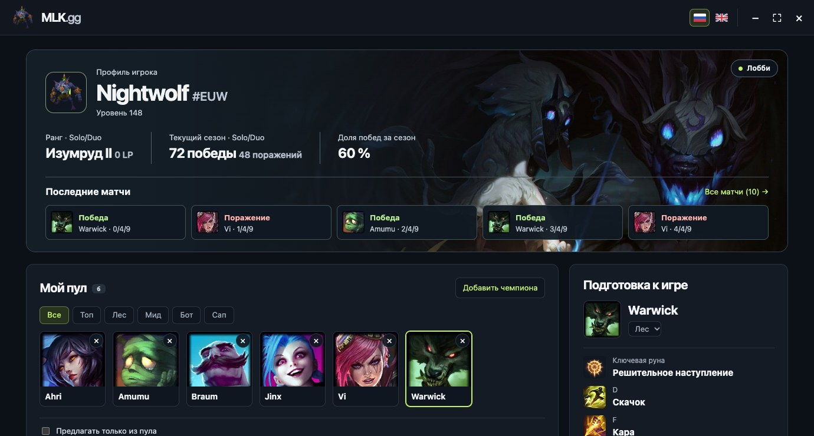

# MLK.gg

Помощник для драфта в League of Legends. В лобби можно посмотреть свой ранг, собрать пул чемпионов и проверить руны. Когда начинается выбор чемпионов, на месте профиля появляются пики, баны и рекомендации для вашей роли.

**[Скачать для Windows](https://github.com/hennygud/loldrafthelper/releases/latest/download/MLK.gg-Windows.zip)** · [Все релизы](https://github.com/hennygud/loldrafthelper/releases) · [Открыть в браузере](https://hennygud.github.io/loldrafthelper/)



## Первый запуск

1. Скачайте и распакуйте **MLK.gg-Windows.zip** целиком.
2. Откройте ярлык **MLK.gg**. Папка `app` должна лежать рядом с ярлыком. Приложение также можно запустить напрямую из неё.
3. Войдите в клиент League of Legends. Профиль появится автоматически. Пока клиент закрыт, можно настроить свой пул.

Язык переключается флагами в правом верхнем углу. Приложение запоминает язык и пул между запусками.

## От лобби до подтверждения пика

| Экран | Возможности |
| --- | --- |
| **Лобби** | Riot ID с тегом, уровень, ранг и LP. Победы, поражения и винрейт берутся за текущий сезон Solo/Duo. Пять последних матчей видны сразу, историю можно раскрыть до десяти. |
| **Подготовка** | Фильтр пула по ролям, поиск чемпионов на русском и английском, просмотр ключевой руны и двух заклинаний призывателя для выбранной роли. |
| **Анализ игр** | Разбор последних 20 игр по модели помощника: оценка вашего пика, место среди вариантов для роли, драфт обеих команд и общие выводы. Открывается кнопкой «Анализ игр» в шапке или нажатием на игру в списке последних матчей, назад — кнопкой «Перейти к драфту». Когда начинается выбор чемпионов, приложение само возвращается к драфту. |
| **Драфт** | Пики и баны поступают из клиента. Портрет препика мигает, подтверждённый пик остаётся неподвижным. Для каждого варианта можно раскрыть оценку матча на линии, игры против состава соперника и синергии с командой. |
| **После подтверждения пика** | Помощник применяет страницу рун и заклинания, если клиент вернул рекомендацию. При повторном выборе использует свою существующую страницу рун. |

## Запуск из исходников

Для настольного окна понадобятся Python и `pywebview`. Команды выполняются из корня репозитория.

```sh
python -m pip install pywebview
python lol_bridge.py
```

Для работы в браузере достаточно Python. Запустите локальный сервер командой ниже и откройте [127.0.0.1:27500](http://127.0.0.1:27500/). Он читает данные из клиента League of Legends на этом компьютере.

```sh
python lol_bridge.py --headless
```

## Сборка для Windows

На Windows с установленным Python запустите `build_exe.bat`. Сборка установит зависимости и сохранит результаты в `dist/`.

- `MLK.gg.exe` — самостоятельное приложение.
- `MLK.gg-Windows.zip` — архив с приложением и ярлыком, готовый к распаковке.

GitHub Actions использует тот же сценарий сборки. Ручной запуск сохраняет артефакты для проверки. При отправке тега вида `v1.2.3` после проверки сборки публикуется релиз с архивом, исполняемым файлом и его контрольной суммой SHA-256. [Сборки Windows](https://github.com/hennygud/loldrafthelper/actions/workflows/build-exe.yml)

## Данные матчей

Рекомендации — это мои правила, проверенные на реальных играх. `stats.json` в корне репозитория попадает в сборку, а приложение раз в 6 часов скачивает его свежую версию из `main`.

1. `collect.py` собирает игры через Riot API в `matches.jsonl`.
2. `analyze.py` считает по ним `stats.json`: роли, винрейты, матчапы, синергии, скейлинг.
3. `validate.py` показывает, каким частям данных можно верить (сравнение двух случайных половин).
4. `node tools/calibrate.js matches.jsonl stats.json` прогоняет правила модели по всем играм и дописывает в `stats.json` вес каждого правила. Правила, которые данные опровергли или в которых эффекта почти нет, приложение перестаёт показывать.

У каждой причины в приложении есть пометка: «моя оценка», «подтверждено данными» или «по данным».

## Где что лежит

| Путь | Назначение |
| --- | --- |
| `tools/calibrate.js` | Проверка правил модели на собранных играх. |
| `index.html` | Общая страница настольного приложения и GitHub Pages. Старые ссылки на `lol_draft_helper.html` ведут на эту страницу. |
| `assets/js/` | Логика драфта и интерфейса, профиль, переводы и справочник игровых данных. |
| `assets/css/` · `assets/img/` | Стили, портреты чемпионов, руны, заклинания и значки приложения. |
| `lol_bridge.py` · `player_profile.py` | Запуск окна, локальный сервер, связь с клиентом League of Legends и чтение профиля. |
| `build_exe.bat` · `scripts/` · `.github/workflows/` | Сборка приложения, упаковка ярлыка и публикация релизов. |
| `docs/` | Изображения для документации. |
